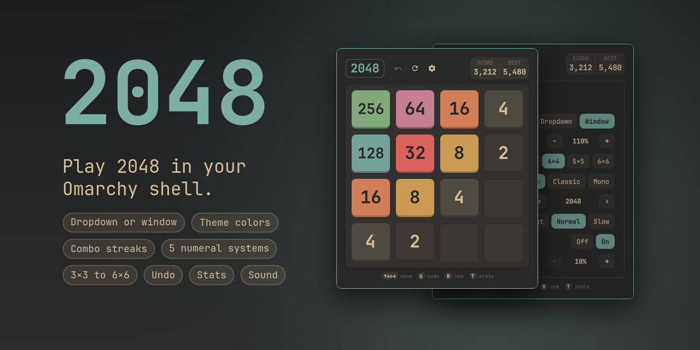

# 2048

**Play 2048 in your Omarchy shell.**



An [Omarchy](https://omarchy.org) bar-widget plugin, one click away in your bar. It
opens as a dropdown under the bar icon or as a floating Hyprland window, with smooth
animations, undo, stats, board sizes from 3×3 to 6×6, and colors taken from your
active theme.

The rules and animation timing are ported from
[gabrielecirulli/2048](https://github.com/gabrielecirulli/2048).

## Features

- Tiles slide, merge with a pop, and spawn with a scale-in. A move that does
  nothing bumps the tiles, and big merges send out glow rings.
- Undo (the last 50 moves, including out of a game over) and a stats page, for all
  board sizes or just the current one.
- A combo badge for three or more scoring moves in a row that heats up as the streak
  grows, and a shimmer and confetti when you win. A new game sweeps the old tiles away.
- Board sizes 3×3 to 6×6. Each size keeps its own game and best score.
- Tile colors from the active Omarchy theme, the original 2048 colors, or a
  single-hue shading of the theme accent.
- A settings page inside the popup, including the window scale and which digits to
  show numbers with (Western, Bengali, Devanagari, Arabic or Kanji).
- Optional sound effects: a low, weighty note per merge that climbs with tile size.
- Your game, best scores and stats are saved between sessions.
- No network access.

## Install

```sh
omarchy plugin add https://github.com/imranZERO/omarchy-2048.git --enable
```

This clones the plugin into `~/.config/omarchy/plugins/imranzero.2048` (the id from
`manifest.json`) and enables it. To enable it later, drop `--enable` and run:

```sh
omarchy plugin enable imranzero.2048
```

It lands on the right side of the bar by default. Drag it to reorder, or:

```sh
omarchy bar move imranzero.2048 left      # or center, right
```

To update: `omarchy plugin update imranzero.2048`.
To remove: `omarchy plugin remove imranzero.2048`. Your saved games and stats stay in
`~/.local/state/omarchy/imranzero-2048.json`; delete that file too if you want them gone.

Omarchy plugins run as unsandboxed code inside the shell, so read the code before you
enable anything. [What it runs and touches](#what-it-runs-and-touches) lists everything
this one does.

## Requirements

- **Omarchy 4** (the Quickshell-based shell). Tested on Omarchy 4.0.0, which ships
  Quickshell 0.3.2 and Hyprland 0.56.2.
- **Python 3**, only for sound. A small script mixes the sounds and plays them through
  `pw-cat`, from the PipeWire that Omarchy already uses.

## Using it

On the bar icon, **left-click** opens the game the way the Open as setting says (a
dropdown by default) and **right-click** always opens it as a floating window.
Either click closes it again.

| Key                  | Action                                            |
|----------------------|---------------------------------------------------|
| Arrows / h j k l     | Move                                              |
| w a s d              | Move                                              |
| u, z, Backspace      | Undo                                              |
| r                    | New game                                          |
| t                    | Stats page                                        |
| o or ,               | Settings page                                     |
| ?                    | Show or hide the key hints (or click the title)   |
| Enter / Space        | The overlay's main button (Try again, Keep going) |
| Esc                  | Leave the stats or settings page, then close      |
| q                    | Close the panel                                   |

The header row has the title and three icon buttons on the left (undo, new game and
settings; hover for a tooltip) and your score and best score on the right. The score
card is a button too: click it to open the stats. The title shows and hides the key
hints under the board, which show by themselves only during your first game. You can
also swipe on the board.

### Commands

```sh
omarchy-shell imranzero.2048 open | close | toggle
omarchy-shell imranzero.2048 move up | right | down | left
omarchy-shell imranzero.2048 undo
omarchy-shell imranzero.2048 newGame
omarchy-shell imranzero.2048 stats
omarchy-shell imranzero.2048 settings
```

### Keybinding

Add a binding in `~/.config/hypr/bindings.lua`, using Omarchy's `{ panel = ... }` form,
which toggles a shell panel by its plugin id:

```lua
o.bind("SUPER + SHIFT + G", "2048", { panel = "imranzero.2048" })
```

This runs `omarchy-shell shell toggle imranzero.2048`, so it follows the Open as setting
like a click on the bar icon does. `SUPER + SHIFT + G` is not used by Omarchy's defaults,
but check yours with `omarchy menu keybindings --print`. To take a key that is already
bound, use `o.rebind(...)` with the same arguments instead of `o.bind(...)`.

## Settings

Edit them on the Settings page inside the popup (the gear icon, or `o`). Changes apply
at once and are saved to your `shell.json` through the shell, the same way
`omarchy bar set` does, so you can also set them from a terminal:

```sh
omarchy bar set imranzero.2048 scale 120 --json
```

| Setting          | Values                   | Notes |
|------------------|--------------------------|-------|
| Open as          | Dropdown, Window         | What left-click does. Right-click always opens a window |
| Window scale     | 60 to 200 %              | Size of everything in the popup or window |
| Board size       | 3 to 6                   | Each size keeps its own game and best score. Goal tile: 256 / 2048 / 4096 / 8192 |
| Tile colors      | Theme, Classic, Mono     | Theme walks the active theme's hues; Classic is the original; Mono shades the accent |
| Numerals         | Western, Bengali, Devanagari, Arabic, Kanji | Digits used on the tiles, scores and stats: 2048, ২০৪৮, २०४८, ٢٠٤٨, 二〇四八. Kanji is positional, one glyph per digit |
| Animation speed  | Off, Fast, Normal, Slow  | The system reduce-motion setting is also respected |
| Sound effects    | on / off (default on)    | |
| Sound volume     | 10 to 100 % (default 60) | |

## Window mode

With Open as set to Window, or when you right-click the icon, the game opens as a
floating window, centered on the active workspace. Move it with Super+drag like any
floating window. The bar icon, `toggle`, Esc and `q` all close it.

The window is exactly as big as the game, so it cannot be resized by hand; use the
Window scale setting. It grows while the Settings page is open and shrinks back after.
Tab (switch to the next bar panel) does nothing in this mode.

The widget makes the window float itself, with no change to your Hyprland config (see
[What it runs and touches](#what-it-runs-and-touches)).

## Undo and stats

Undo steps back through the last 50 moves of the current game. The history lasts while
the shell runs and is not saved across restarts.

The stats page shows games, wins, moves, best tile and the best score, for everything or
for the current board size (switch at the top right; per-size numbers count from the
version that added them, so they start at zero for an old save). Open it by clicking the score card, with `t`, or with the `stats` command.
A game counts from its first move; undoing that move takes it back. Reset stats clears
the counts and the best scores for every board size; saved games are kept.

## Sound

On by default; turn it off in Settings. One profile: a pitch-dropping "bloop" over a
thump, with a short bright tick on the attack. Merges climb a pentatonic scale from C2,
so bigger tiles ring higher and hit a little harder. A streak of three or more scoring
moves adds a quiet high note after the move's own sound, climbing with the streak.

- Every sound is matched to the same A-weighted loudness, so a small merge and a big one
  sound equally loud.
- Each merge is played up to 40 cents sharper or flatter at random (a cent is a
  hundredth of a semitone), never within 15 cents of the last one, so a long game does
  not repeat the identical sound.
- Audio outputs sleep when idle and wake slowly (a USB DAC can take a few hundred
  milliseconds), which clips or swallows the first sound. While the popup is open, and
  for 20 seconds after, a mixer process keeps one PipeWire stream, named "2048", playing
  (silent between sounds) so the output stays ready. It stops when you close the popup.

**One stream, not one per sound.** The mixer (`mixer.py`) keeps a single PipeWire stream
open and mixes every sound into it. The obvious design, starting a `pw-cat` for each
sound, made PipeWire's session manager (WirePlumber) use about a quarter of a CPU core at
a fast pace, because every sound is a new stream to set up and tear down, and that churn
also slowed the shell's own audio widgets. With the mixer, WirePlumber's use drops to
under 1%, and the mixer itself takes a few percent of a core only while sounds are
playing. It makes the pitch variations itself, caches them, and keeps its buffer small
enough that sounds start as fast as they did before.

The sounds are headerless 16-bit mono PCM at 24 kHz, about 280 KB in total. To hear one:

```sh
pw-cat -p --raw --rate 24000 --channels 1 --format s16 sounds/merge3.pcm
```

## What it runs and touches

- **Runs `omarchy bar set`**, only from the Settings page, to save its own settings.
- **Runs `hyprctl eval`**, only in window mode, to add a window rule for a window titled
  "2048". Nothing else about your Hyprland setup is changed. The rule is added on every
  open, because a config reload drops runtime rules.
- **Runs `python3 mixer.py`**, only when sound is on, which in turn runs one `pw-cat`
  to play the mixed sound. Both stop shortly after the popup closes.
- **Reads** `~/.local/state/omarchy/current/theme/colors.toml`, for the theme's colors.
- **Reads and writes** `~/.local/state/omarchy/imranzero-2048.json`: your games, best
  scores and stats.
- **Writes** its own entry in `~/.config/omarchy/shell.json`, through `omarchy bar set`.
- It opens no network connections.

## Troubleshooting

- **Icons show as empty boxes:** the UI needs a Nerd Font. Omarchy's default has one.
- **Numbers show as empty boxes with another Numerals setting:** the system needs a font
  with those digits (Noto Sans Bengali, Devanagari, Arabic or CJK cover all of them).
- **No sound:** check that Sound effects is on in Settings and that `python3` and
  `pw-cat` exist. The first sound after a long idle can be clipped only when the mixer is
  not running, for example when a move arrives through `omarchy-shell` while the popup is
  closed.
- **The window opens tiled:** the float rule did not apply. It relies on Hyprland's Lua
  config interface (`hyprctl eval`), so a Hyprland update that changes that interface
  can break it. Add a permanent rule to `~/.config/hypr/hyprland.lua` instead:

  ```lua
  o.window({ class = "org.quickshell", title = "^2048$" }, { float = true, center = true })
  ```
- **QML edits do not show up:** run `omarchy restart shell`. The shell caches compiled
  QML by path, and its file watcher does not follow a symlinked plugin folder.

## Development

```sh
git clone https://github.com/imranZERO/omarchy-2048.git ~/Work/omarchy-2048
ln -s ~/Work/omarchy-2048 ~/.config/omarchy/plugins/imranzero.2048
omarchy plugin validate ~/Work/omarchy-2048
omarchy-shell shell rescanPlugins
omarchy plugin enable imranzero.2048
```

`omarchy plugin validate` checks the manifest and refuses symlinks inside the plugin
folder, so keep the folder free of them. The symlink above is outside it, which is fine.

| File | What it is |
|------|------------|
| `manifest.json` | Plugin id, entry point and where it sits in the bar |
| `Panel.qml` | Entry point: bar icon, dropdown and window, settings, undo, saving, commands |
| `Board.qml`, `Tile.qml` | The grid, the tile model and every tile animation |
| `Game.js` | The rules, in pure JS with no QML in it |
| `Stats.js` | Lifetime stats, in pure JS |
| `Numerals.js` | The digit sets for the Numerals setting, in pure JS |
| `StatsView.qml`, `SettingsView.qml`, `ScoreBox.qml` | The stats page, the settings page, the score boxes |
| `HeaderButton.qml`, `ScorePill.qml`, `KeyHint.qml` | The icon buttons, the SCORE and BEST capsule (which opens the stats), and the key caps under the board |
| `ThemePalette.qml` | Reads the theme's hue palette from `colors.toml` |
| `Sound.qml`, `mixer.py` | Sends sounds to the mixer, which mixes them into one PipeWire stream and keeps the output awake |
| `sounds/` | The generated sound files |
| `tools/make-sounds.py` | Regenerates `sounds/` with stdlib Python; the knobs are at the top |

## License

MIT, see [LICENSE](LICENSE). The game rules and design are Gabriele Cirulli's original
2048, also MIT.
